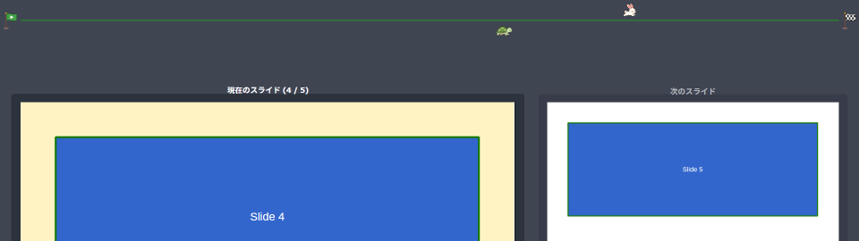

# Presentation Pace Tracker – Installation and User Guide

Works with LibreOffice 7.4 or later (tested with LibreOffice 26.8.1.1 on Windows).

---

## 1. Get the extension file (.oxt)

The ready-to-install package is (`<version>` is the version number, for example `PresentationPaceTracker-1.0.0.oxt`):

```
dist/PresentationPaceTracker-<version>.oxt
```

If you changed the sources in `src/`, rebuild the package (requires Python 3):

```
python tools/build_oxt.py
```

The version number is set in one place only: the `VERSION` file in the repository root. The build writes it into `src/description.xml` and uses it in the name of the .oxt file.

## 2. Install it in LibreOffice

### Option A: Extension Manager (recommended)

1. Start LibreOffice (Impress).
2. Open **Tools > Extensions...** (Ctrl+Alt+E).
3. Click **Add...** and select `PresentationPaceTracker-<version>.oxt`.
4. If asked whether to install for all users or only for you, choose **Only for me**.
5. The license (Mozilla Public License 2.0) is shown. Scroll to the end and click **Accept**.
6. When "Presentation Pace Tracker <version>" appears in the list, click **Close** and **restart LibreOffice** when prompted.

> Double-clicking the .oxt file in your file manager opens the same dialog.

### Option B: Command line

**Close all LibreOffice windows first** (including the Quickstarter), then run:

Windows (PowerShell):

```powershell
& "C:\Program Files\LibreOffice\program\unopkg.com" add "C:\path\to\PresentationPaceTracker-<version>.oxt"
& "C:\Program Files\LibreOffice\program\unopkg.com" list
```

Linux / macOS:

```
unopkg add /path/to/PresentationPaceTracker-<version>.oxt
unopkg list
```

(On macOS, `unopkg` is in `/Applications/LibreOffice.app/Contents/MacOS/`.)

The extension is installed when `list` shows `Identifier: jp.atmitani.impress.pacetracker` and `is registered: yes`.

### Update / remove

- Update: add the new .oxt the same way. You are asked whether to replace the installed version (on the command line use `unopkg add -f ...`).
- Remove: select it in **Tools > Extensions** and click **Remove**, or run
  `unopkg remove jp.atmitani.impress.pacetracker`

## 3. Usage


1. Open the presentation you are going to give in Impress.
2. Choose **Tools > Add-Ons > Presentation Pace Tracker > Settings...**
   (You can also show the add-on toolbar under **View > Toolbars** and use its button.)
3. Enter the **Planned duration** in minutes and seconds (for example 20 min 0 sec).
4. Click **Start**.
   - The elapsed time measurement starts.
   - If **Also start the slide show** is checked, the slide show starts too.
     If it is unchecked, start the slide show yourself (for example with F5).
   - If **Skip the title slide: start measuring at slide 2** is checked, the measurement does not start while slide 1 is shown (the state line says "waiting for slide 2"). The elapsed time is measured from the moment slide 2 is shown. Use this when the title slide is shown before the talk starts. See "Skip the title slide" below.
5. A progress band appears at the bottom of the slide show. It has no background: only the flags, the icons and the line in the middle are drawn over the slide.


| Element | Meaning |
|---|---|
| Icon on the left (default: green flag) | Start |
| Icon on the right (default: checkered flag) | Goal |
| Upper icon (default: rabbit) | Slide progress. At the start on the first slide, at the goal on the last slide. Moves back to the left when you go back to an earlier slide |
| Lower icon (default: turtle) | Elapsed time. Reaches the goal at the planned duration. Keeps moving forward even when you go back to an earlier slide |
| Color of the line in the middle | Green: on time or ahead / Orange: slightly behind / Red: behind (or out of time) |

If the rabbit is to the right of the turtle, you are on pace to finish on time.

6. **Reset** sets the elapsed time back to 0, stops the measurement and moves both icons back to the start. If the slide show is running, it returns to the first slide. Click **Start** again to measure again.
7. Closing the dialog with **Close** does not stop the measurement. Open it again to check the state.

### Skip the title slide

If the title slide (slide 1) is shown before the talk starts, check **Skip the title slide: start measuring at slide 2** in the dialog.

- If slide 1 is shown when you click **Start**, the measurement waits for slide 2 and the time icon does not move.
- The elapsed time is measured from the moment slide 2 is shown.
- Slide progress runs from slide 2 to the last slide (start at slide 2, goal at the last slide).
- If slide 2 or a later slide is already shown when you click **Start**, the measurement starts immediately.
- **Reset** also cancels the waiting state and returns the slide show to slide 1. Click **Start** again to wait for slide 2 again.
- The setting is saved and used next time.

### Show the progress only to the presenter (Show on)

Use **Show on** in the **Display area** section of the dialog to choose where the band is shown.

| Show on | Screen |
|---|---|
| Slides (audience) | The slide show screen (default). The audience sees it too |
| Presenter Console only | Only the Presenter Console (the presenter's screen). It is not shown on the slides the audience sees |



- The Presenter Console appears on the presenter's screen when you start a slide show with two displays connected. **Tools > Options > LibreOffice Impress > General > Enable Presenter Console** must be checked.
- If **Presenter Console only** is selected and no Presenter Console is shown (for example with a single display), the band is not shown anywhere. The state line of the dialog then says "hidden, no Presenter Console".
- Changes are applied immediately, even while the slide show is running. The selection is saved.

### Change the position and size of the progress band

Use the **Display area** section of the dialog. All values are percentages of the screen the band is shown on.
Position and size are saved **separately for each Show on target**. When you switch the target, the fields switch to that target's values.

| Field | Meaning | Default (slides) | Default (Presenter Console) | Allowed range |
|---|---|---|---|---|
| Position X | Left edge of the band, measured from the **left** edge of the screen | 0 % | 0 % | 0–95 % |
| Position Y | Slides: bottom edge of the band, measured from the **bottom** edge of the screen<br>Presenter Console: top edge of the band, measured from the **top** edge of the screen | 0 % (from bottom) | 0 % (from top) | 0–95 % |
| Width | Width of the band, relative to the screen width | 100 % | 100 % | 5–100 % |
| Height | Height of the band, relative to the screen height | 8.5 % | 8.5 % | 2–50 % |

- On the Presenter Console the band is shown at the top by default, so that it does not cover the console's own buttons (Previous, Next, Pause, ...) at the bottom.
- **The reference edge of Position Y depends on the target:** from the bottom on the slides, from the top on the Presenter Console. The label next to the Y field ("% from bottom" / "% from top") switches accordingly. In both cases you enter the distance from that edge as is; for example Y = 5 places the band 5 % above the bottom on the slides and 5 % below the top on the Presenter Console.
- Changes are applied immediately, even while the slide show is running.
- The values are saved automatically. They are kept after **Reset** and after restarting LibreOffice.
- If the band would extend beyond the screen, it is moved back onto the screen.
- So that the flags and icons fit, the band is at least 24 pixels high and at least four times as wide as it is high.

Example: to raise the band 5 % from the bottom and leave a 20 % margin on both sides, use X = 20, Y = 5, Width = 60.

### Change the dialog language

Choose it with **Language** at the bottom left of the dialog.

| Choice | Dialog language |
|---|---|
| Auto (LibreOffice UI language) | Japanese if the LibreOffice user interface is Japanese, otherwise English (default) |
| 日本語 | Always Japanese |
| English | Always English |

- The dialog is redrawn in the selected language right away. A running measurement is not affected.
- The selected language is saved and used next time.
- The menu entries (**Tools > Add-Ons**) follow the LibreOffice user interface language.

### Change the icons

In the **Icons** section you can replace each of the four icons.

| Icon | Default | Where it is shown |
|---|---|---|
| Time icon | Turtle | Moves along the lower row |
| Slide icon | Rabbit | Moves along the upper row |
| Start icon | Green flag | Left end |
| Goal icon | Checkered flag | Right end |

- **Upload...**: select a PNG / SVG / JPEG / GIF / BMP / WebP image to replace the icon (a square PNG with a transparent background looks best).
- **Default**: go back to the default icon in the table above.
- All four icons are shown at the same size (derived from the height of the band).

Uploaded images and settings are stored in your LibreOffice user profile and are used again next time:

| OS | Folder |
|---|---|
| Windows | `%APPDATA%\LibreOffice\4\user\pacetracker\` |
| Linux | `~/.config/libreoffice/4/user/pacetracker/` |
| macOS | `~/Library/Application Support/LibreOffice/4/user/pacetracker/` |

```
settings.json      planned duration, check boxes (start slide show, skip title slide), Show on target, display areas, icons and language
time_icon_*.png    uploaded time icon
slide_icon_*.png   uploaded slide icon
start_icon_*.png   uploaded start icon
goal_icon_*.png    uploaded goal icon
pacetracker.log    log written when an error occurs
```

## 4. Notes and troubleshooting

- **The progress band is shown in full screen slide shows.** It may not appear if the slide show is set to run in a window (**Slide Show > Slide Show Settings**).
- The band is drawn on top of the slide (by default at the bottom of the screen, 8.5 % high). If the flags or icons cover slide content, change the position or size under **Display area**.
- The band is made to look transparent. LibreOffice cannot draw really transparent windows over a slide show, so the square around each icon is filled with the **slide background color** (on the Presenter Console: the console's background color).
  - With a plain color slide background, nothing shows around the icons.
  - With a gradient background the end color is used, and with a picture or pattern background white is used, so a square may be visible around the icons.
  - Slide text or shapes right behind an icon are hidden by the icon's square (not between the icons).
- Slide progress is based on the slides shown in the slide show (hidden slides are not counted).
- The menu entry is missing: make sure LibreOffice was fully restarted after the installation (including the Quickstarter).
- The dialog does not open: at least one Impress presentation must be open.
- If something does not work as expected, check `pacetracker.log`.
