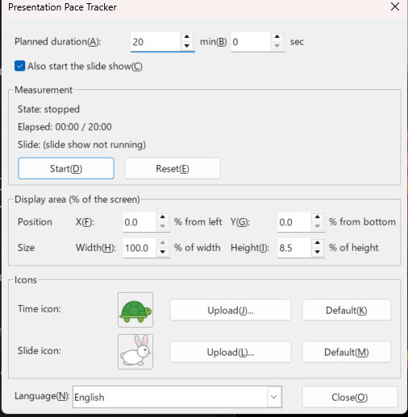
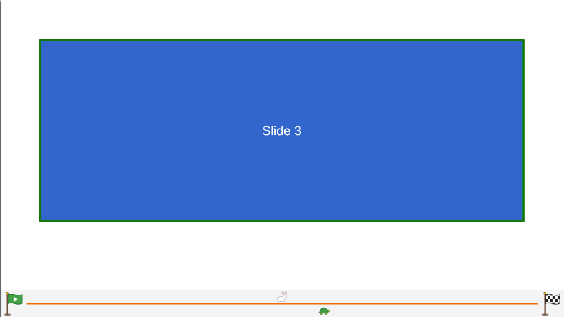

# Presentation Pace Tracker – Installation and User Guide

Works with LibreOffice 7.4 or later (tested with LibreOffice 26.8.1.1 on Windows).

---

## 1. Get the extension file (.oxt)

The ready-to-install package is:

```
dist/PresentationPaceTracker-1.0.0.oxt
```

If you changed the sources in `src/`, rebuild the package (requires Python 3):

```
python tools/build_oxt.py
```

## 2. Install it in LibreOffice

### Option A: Extension Manager (recommended)

1. Start LibreOffice (Impress).
2. Open **Tools > Extensions...** (Ctrl+Alt+E).
3. Click **Add...** and select `PresentationPaceTracker-1.0.0.oxt`.
4. If asked whether to install for all users or only for you, choose **Only for me**.
5. The license (Mozilla Public License 2.0) is shown. Scroll to the end and click **Accept**.
6. When "Presentation Pace Tracker 1.0.0" appears in the list, click **Close** and **restart LibreOffice** when prompted.

> Double-clicking the .oxt file in your file manager opens the same dialog.

### Option B: Command line

**Close all LibreOffice windows first** (including the Quickstarter), then run:

Windows (PowerShell):

```powershell
& "C:\Program Files\LibreOffice\program\unopkg.com" add "C:\path\to\PresentationPaceTracker-1.0.0.oxt"
& "C:\Program Files\LibreOffice\program\unopkg.com" list
```

Linux / macOS:

```
unopkg add /path/to/PresentationPaceTracker-1.0.0.oxt
unopkg list
```

(On macOS, `unopkg` is in `/Applications/LibreOffice.app/Contents/MacOS/`.)

The extension is installed when `list` shows `Identifier: jp.atmitani.impress.pacetracker` and `is registered: yes`.

### Update / remove

- Update: add the new .oxt the same way. You are asked whether to replace the installed version (on the command line use `unopkg add -f ...`).
- Remove: select it in **Tools > Extensions** and click **Remove**, or run
  `unopkg remove jp.atmitani.impress.pacetracker`

## 3. Usage



1. Open the presentation you are going to give in Impress.
2. Choose **Tools > Add-Ons > Presentation Pace Tracker > Settings...**
   (You can also show the add-on toolbar under **View > Toolbars** and use its button.)
3. Enter the **Planned duration** in minutes and seconds (for example 20 min 0 sec).
4. Click **Start**.
   - The elapsed time measurement starts.
   - If **Also start the slide show** is checked, the slide show starts too.
     If it is unchecked, start the slide show yourself (for example with F5).
5. A progress band appears at the bottom of the slide show.



| Element | Meaning |
|---|---|
| Green flag on the left | Start |
| Checkered flag on the right | Goal |
| Upper icon (default: rabbit) | Slide progress. At the start on the first slide, at the goal on the last slide. Moves back to the left when you go back to an earlier slide |
| Lower icon (default: turtle) | Elapsed time. Reaches the goal at the planned duration. Keeps moving forward even when you go back to an earlier slide |
| Color of the line in the middle | Green: on time or ahead / Orange: slightly behind / Red: behind (or out of time) |

If the rabbit is to the right of the turtle, you are on pace to finish on time.

6. **Reset** sets the elapsed time back to 0, stops the measurement and moves both icons back to the start. If the slide show is running, it returns to the first slide. Click **Start** again to measure again.
7. Closing the dialog with **Close** does not stop the measurement. Open it again to check the state.

### Change the position and size of the progress band

Use the **Display area** section of the dialog. All values are percentages of the slide show screen.

| Field | Meaning | Default | Allowed range |
|---|---|---|---|
| Position X | Left edge of the band, measured from the **left** edge of the screen | 0 % | 0–95 % |
| Position Y | Bottom edge of the band, measured from the **bottom** edge of the screen | 0 % | 0–95 % |
| Width | Width of the band, relative to the screen width | 100 % | 5–100 % |
| Height | Height of the band, relative to the screen height | 8.5 % | 2–50 % |

- Changes are applied immediately, even while the slide show is running.
- The values are saved automatically. They are kept after **Reset** and after restarting LibreOffice.
- If the band would extend beyond the screen, it is moved back onto the screen.
- So that the flags and icons fit, the band is at least 24 pixels high and at least four times as wide as it is high.

Example: to raise the band 5 % from the bottom and leave a 20 % margin on both sides, use X = 20, Y = 5, Width = 60.

### Change the dialog language

Choose it with **Language** at the bottom left of the dialog.

| Choice | Dialog language |
|---|---|
| Auto (LibreOffice UI language) | Japanese if the LibreOffice user interface is Japanese, otherwise English (default) |
| 日本語 | Always Japanese |
| English | Always English |

- The dialog is redrawn in the selected language right away. A running measurement is not affected.
- The selected language is saved and used next time.
- The menu entries (**Tools > Add-Ons**) follow the LibreOffice user interface language.

### Change the icons

In the **Icons** section, for both the time icon and the slide icon:

- **Upload...**: select a PNG / SVG / JPEG / GIF / BMP / WebP image to replace the icon (a square PNG with a transparent background looks best).
- **Default**: go back to the turtle (time) or the rabbit (slide).

Uploaded images and settings are stored in your LibreOffice user profile and are used again next time:

| OS | Folder |
|---|---|
| Windows | `%APPDATA%\LibreOffice\4\user\pacetracker\` |
| Linux | `~/.config/libreoffice/4/user/pacetracker/` |
| macOS | `~/Library/Application Support/LibreOffice/4/user/pacetracker/` |

```
settings.json      planned duration, check box, display area, icons and language
time_icon_*.png    uploaded time icon
slide_icon_*.png   uploaded slide icon
pacetracker.log    log written when an error occurs
```

## 4. Notes and troubleshooting

- **The progress band is shown in full screen slide shows.** It may not appear if the slide show is set to run in a window (**Slide Show > Slide Show Settings**).
- The band is drawn on top of the slide (by default at the bottom of the screen, 8.5 % high). If it covers slide content, change its position or size under **Display area**.
- Right after a slide change the band is redrawn after the slide show has repainted the screen, so it may disappear for a moment.
- Slide progress is based on the slides shown in the slide show (hidden slides are not counted).
- The menu entry is missing: make sure LibreOffice was fully restarted after the installation (including the Quickstarter).
- The dialog does not open: at least one Impress presentation must be open.
- If something does not work as expected, check `pacetracker.log`.
