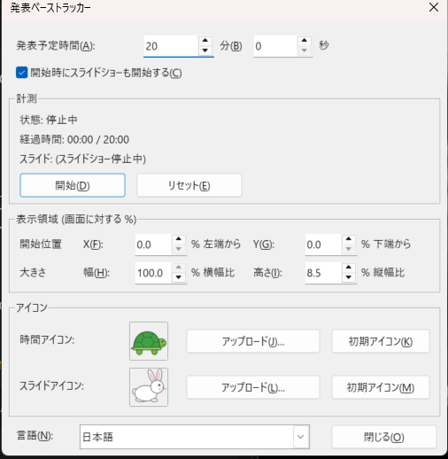

# 発表ペーストラッカー ― ローカルPCの Impress への導入・利用手順

対象: LibreOffice 26.8.1.1（Windows）／ LibreOffice 7.4 以降で動作します。
LibreOffice のインストール先: `C:\Program Files\LibreOffice\program\soffice.exe`

---

## 1. 拡張機能ファイル（.oxt）を用意する

配布用ファイルはビルド済みです。

```
dist\PresentationPaceTracker-1.0.0.oxt
```

ソース（`src\`）を変更した場合は、次のコマンドで作り直します（Python 3 が必要）。

```powershell
cd C:\Users\atmit\home\2026\LibreOffice\Impress\Extension
python tools\build_oxt.py
```

## 2. Impress に取り込む

### 方法A: 拡張機能マネージャーを使う（推奨）

1. LibreOffice（Impress）を起動します。
2. メニュー **ツール > 拡張機能...**（Ctrl+Alt+E）を開きます。
3. **追加...** をクリックし、`dist\PresentationPaceTracker-1.0.0.oxt` を選びます。
4. 「自分だけ」/「このコンピュータのすべてのユーザー」を聞かれたら **自分だけ** を選びます。
5. ライセンス（Mozilla Public License 2.0）が表示されるので、最後までスクロールして **同意する** をクリックします。
6. 一覧に「発表ペーストラッカー 1.0.0」が表示されたら **閉じる** をクリックし、表示される案内に従って **LibreOffice を再起動** します。

> .oxt ファイルをエクスプローラーでダブルクリックしても同じ画面が開きます。

### 方法B: コマンドラインで入れる

**LibreOffice をすべて終了してから**（クイック起動も含む）、PowerShell で実行します。

```powershell
& "C:\Program Files\LibreOffice\program\unopkg.com" add "C:\Users\atmit\home\2026\LibreOffice\Impress\Extension\dist\PresentationPaceTracker-1.0.0.oxt"
& "C:\Program Files\LibreOffice\program\unopkg.com" list
```

`list` の結果に `Identifier: jp.atmitani.impress.pacetracker` と `is registered: yes` が出れば導入済みです。

### 更新・削除

- 更新: 新しい .oxt を同じ手順で追加すると、上書きするか聞かれます（コマンドなら `unopkg add -f ...`）。
- 削除: **ツール > 拡張機能** で選んで **削除**、またはコマンドで
  `unopkg remove jp.atmitani.impress.pacetracker`

## 3. 使い方



1. Impress で発表するプレゼンテーションを開きます。
2. **ツール > アドオン > 発表ペーストラッカー > 管理画面を開く...** を選びます。
   （**表示 > ツールバー > アドオン** を表示すると、ツールバーのボタンからも開けます。）
3. **発表予定時間** に分・秒を入力します（例: 20 分 0 秒）。
4. **開始** を押します。
   - 経過時間の計測が始まります。
   - 「開始時にスライドショーも開始する」にチェックがあれば、スライドショーも同時に始まります。
     チェックを外した場合は、F5 などで自分でスライドショーを始めてください。
5. スライドショー画面の下端に進捗バーが表示されます。


| 表示 | 意味 |
|---|---|
| 左端の緑の旗 | スタート |
| 右端のチェッカーフラッグ | ゴール |
| 上段のアイコン（初期: ウサギ） | スライドの進捗。最初のスライドでスタート、最後のスライドでゴール。前のスライドに戻すと左へ戻ります |
| 下段のアイコン（初期: カメ） | 経過時間。予定時間でゴールに着きます。スライドを戻しても止まらずに進みます |
| 中央の線の色 | 緑: 予定どおりかそれより早い／オレンジ: やや遅れ／赤: 遅れ（または時間切れ） |

ウサギがカメより右にいれば、時間内に終わるペースです。

6. **リセット** を押すと、経過時間が 0 に戻って計測が止まり、両方のアイコンがスタートに戻ります。スライドショーの実行中なら先頭スライドに戻ります。もう一度 **開始** を押すと計測を再開します。
7. 管理画面は **閉じる** で閉じても計測は続きます。もう一度開くと状態を確認できます。

### 進捗バーの表示位置と大きさを変える

管理画面の **表示領域** 欄で指定します。値はすべてスライドショー画面に対する割合（%）です。

| 項目 | 意味 | 初期値 | 入力できる範囲 |
|---|---|---|---|
| 開始位置 X | バーの左端の位置。画面の **左端** からの距離 | 0 % | 0〜95 % |
| 開始位置 Y | バーの下端の位置。画面の **下端** からの距離 | 0 % | 0〜95 % |
| 幅 | バーの横幅。画面の横幅に対する割合 | 100 % | 5〜100 % |
| 高さ | バーの高さ。画面の縦の高さに対する割合 | 8.5 % | 2〜50 % |

- スライドショーの実行中に値を変えても、すぐに表示に反映されます。
- 入力した値は自動で保存されます。**リセット** を押しても、LibreOffice を再起動しても、最後に入力した値のままです。
- 画面からはみ出す値の場合は、画面に収まる位置に寄せて表示します。
- 旗とアイコンが並ぶように、高さは最低 24 ピクセル、幅は最低で高さの 4 倍になります。

例: 画面下から 5 % 上げて、左右に 20 % ずつ余白を空けたい → X = 20、Y = 5、幅 = 60

### 管理画面の言語を切り替える

管理画面の左下の **言語** で選びます。

| 選択肢 | 表示 |
|---|---|
| 自動 (LibreOffice の表示言語) | LibreOffice の表示言語が日本語なら日本語、それ以外は英語（初期値） |
| 日本語 | 常に日本語 |
| English | 常に英語 |

- 選ぶとすぐに管理画面が選んだ言語で表示し直されます。計測は止まりません。
- 選んだ言語は保存され、次回以降も使われます。
- メニュー（**ツール > アドオン**）の表示は、LibreOffice 本体の表示言語に従います。

英語表示の管理画面:


### アイコンを変える

管理画面の **アイコン** 欄で、時間アイコン・スライドアイコンそれぞれ:

- **アップロード...**: PNG / SVG / JPEG / GIF / BMP / WebP の画像を選ぶと差し替わります（背景が透明な正方形の PNG がきれいに表示されます）。
- **初期アイコン**: カメ（時間）／ウサギ（スライド）に戻します。

アップロードした画像と設定は、LibreOffice のユーザープロファイル内に保存され、次回起動時も使われます。

```
%APPDATA%\LibreOffice\4\user\pacetracker\
    settings.json      … 予定時間・チェックボックス・表示領域・アイコン・言語の設定
    time_icon_*.png    … アップロードした時間アイコン
    slide_icon_*.png   … アップロードしたスライドアイコン
    pacetracker.log    … エラーが起きたときのログ
```

## 4. 注意点・トラブルシューティング

- **進捗バーは全画面のスライドショーに表示されます。** スライドショーの設定（**スライドショー > スライドショーの設定**）で「ウィンドウ」モードにしている場合は表示されないことがあります。
- 進捗バーはスライドに重ねて表示されます（初期値は画面の下端、高さ 8.5 %）。スライドの内容と重なるときは、管理画面の **表示領域** で位置や大きさを変えてください。
- スライドが切り替わった直後は、スライドショーの再描画のあとに進捗バーが描き直されるため、一瞬バーが消えて見えることがあります。
- スライドの進捗は「スライドショーで表示されるスライド」の枚数で計算します（非表示スライドは数えません）。
- メニューに項目が出ない: 導入後に LibreOffice を完全に再起動したか確認してください（タスクトレイのクイック起動も終了）。
- 管理画面が出ない: Impress の文書が 1 つも開いていないと動きません。Impress の文書を開いてから実行してください。
- 動作がおかしいときは `pacetracker.log` を確認してください。
